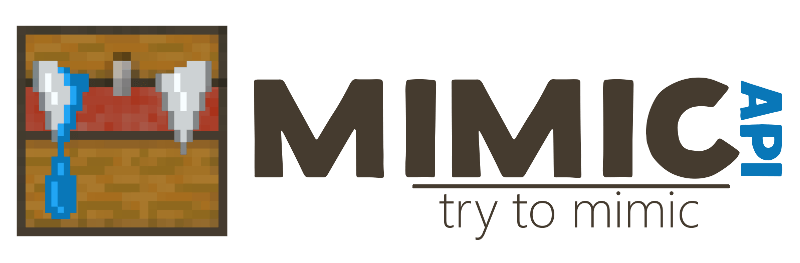

**One API for every RPG plugin.**  
Think of it as [Vault](https://www.spigotmc.org/resources/34315/) for RPG plugins: Vault connects plugins to any economy or permissions plugin, Mimic does the same for levels, classes, items and blocks.

You only need Mimic if another plugin requires it.

## Installation

1. Make sure you run **Paper 1.20.6+** (or a fork) on **Java 21**.
2. Put Mimic into the `plugins/` folder.
3. Restart the server.

That's it. Mimic detects installed RPG plugins automatically.

## Supported plugins

| API            | Plugins                                                                                  |
|----------------|------------------------------------------------------------------------------------------|
| **Levels**     | Vanilla experience, MMOCore, Heroes, SkillAPI, BattleLevels, QuantumRPG                  |
| **Classes**    | Permissions (`mimic.class.<name>`), MMOCore, Heroes, SkillAPI, QuantumRPG                |
| **Items**      | Vanilla items, CraftEngine, MMOItems, CustomItems, QuantumRPG, ItemsAdder¹, RPGInventory¹ |
| **Blocks**     | Vanilla blocks, CraftEngine                                                              |
| **Inventory**  | Vanilla inventory, RPGInventory¹                                                         |

¹ Support is provided by the plugin itself.

Is your favorite plugin missing? [Open an issue](https://github.com/EndlessCodeGroup/Mimic/issues) or ask its author to support Mimic.

## Configuration

If several plugins provide the same feature, choose which one to use with `/mimic config`.
Every option in its output is clickable.

## Commands

All commands require the `mimic.admin` permission.

| Command            | Description                          |
|--------------------|--------------------------------------|
| `/mimic`           | Show Mimic status                    |
| `/mimic config`    | Show and change Mimic config         |
| `/mimic xp`        | Manage player's level and experience |
| `/mimic class`     | Check player's classes               |
| `/mimic inventory` | Player's inventory info              |
| `/mimic items`     | Give, find and compare items         |
| `/mimic blocks`    | Set, break, find and compare blocks  |

Commands without arguments show info and list available subcommands: click a subcommand to use it, hover to see usage.

## Links

- [Item and block ID formats](https://github.com/EndlessCodeGroup/Mimic/tree/develop/mimic-bukkit#supported-implementations) — for configuring plugins that use Mimic IDs
- [Developer guide](https://github.com/EndlessCodeGroup/Mimic/tree/develop/mimic-bukkit-api)
- [Source code](https://github.com/EndlessCodeGroup/Mimic)
- [Discord](https://discord.gg/5NfPsgb)
