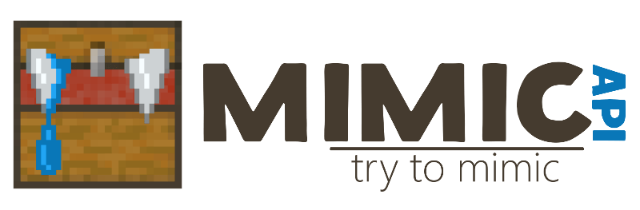

# Mimic
[][mavenCentral]
[][ci]
[][codacy]
[][license]

[](#)

Abstraction API for RPG plugins.

Other resources:
[SpigotMC](https://www.spigotmc.org/resources/82515/),
[SpigotMC Forum](https://www.spigotmc.org/threads/456931/),
[RuBukkit](http://rubukkit.org/threads/134308/)  
Join us: [](https://discord.gg/5NfPsgb)

## What is MimicAPI?
The goal of MimicAPI is to make RPG plugins compatible with each other.

There is a lot of RPG plugins and to integrate them together you need to get copies of all these plugins (some of which are paid).
Inspired by [Vault], I wrote MimicAPI to avoid this problem.  
With Mimic, you don't need to download all RPG plugins and write specific code for each plugin to support them, just use Mimic as a dependency.

### Available APIs

- [Levels] - API to work with player's levels: classes, skills, professions or jobs a player levels up in.
  Makes it possible to use levels from several plugins at once.
- [LevelSystem] *(deprecated, use [Levels])* - API to work with player's single level and experience points.
- [Classes] - API to work with player's classes: classes and races held in class slots, with subclasses and class levels.
  Makes it possible to use classes from several plugins at once.
- [ClassSystem] *(deprecated, use [Classes])* - API to work with player's classes.
- [Resources] - API to work with player's resources: mana, stamina and similar. Read them, take costs, give them back.
- [PlayerInventory] *(experimental)* - API to access player's inventories content.
- [Items] - API to create and identify vanilla items and custom items created with plugins.
- [ItemsRegistry] *(deprecated, use [Items])* - API to create and validate custom items created with plugins.
- [Blocks] - API to identify, set and break vanilla blocks and custom blocks created with plugins.

### Implementations

#### Bukkit
- [mimic-bukkit-api](mimic-bukkit-api) - mimic-api adopted for Bukkit. Use it in Paper plugins.
- [mimic-bukkit](mimic-bukkit) - Bukkit plugin containing some APIs implementations.
It also provides commands to test your API implementation.
Use it as example of Mimic APIs usage and implementation.

## Installation

If you are server owner, just get needed plugin from [Implementations](#implementations) section.
If you are developer you can use [Gradle] or [Maven] to plug MimicAPI to your plugin.

Mimic requires [Paper] 1.20.6+ and Java 21.

### Gradle

```kotlin
repositories {
    mavenCentral()
}

dependencies {
    compileOnly("ru.endlesscode.mimic:mimic-bukkit-api:0.10.0")
}
```

### Maven
```xml
<dependency>
  <groupId>ru.endlesscode.mimic</groupId>
  <artifactId>mimic-bukkit-api</artifactId>
  <version>0.10.0</version>
  <scope>provided</scope>
</dependency>
```

## Usage

> Look [Implementations](#implementations) pages for API usage examples on your platform.

## Contributing
Pull requests are welcome.
For major changes, please open an issue first to discuss what you would like to change.

Please make sure to update tests as appropriate.

## AI usage

Mimic was started in 2017 and was written by hand for most of its history.
Since late 2026 it is developed with the help of AI. It is the only way I can keep this project going in the time I have.

**Public API is designed by me.** AI doesn't decide what the API looks like.

**AI helps with:**

- Research: how RPG and item plugins expose their data and how other plugins consume it.
- Implementation behind the API, and integrations with other plugins.
- Review, refactoring, tests, and splitting changes into reviewable commits.

I review the code before it is merged.

[codacy]: https://www.codacy.com/app/EndlessCode-Group/MimicAPI?utm_source%3Dgithub.com%26amp;utm_medium%3Dreferral%26amp;utm_content%3DEndlessCodeGroup/MimicAPI%26amp;utm_campaign%3DBadge_Grade
[mavenCentral]: https://search.maven.org/search?q=g:ru.endlesscode.mimic
[ci]: https://github.com/EndlessCodeGroup/Mimic/actions/
[license]: LICENSE

[Vault]: https://github.com/MilkBowl/Vault
[Gradle]: https://gradle.org/
[Maven]: https://maven.apache.org/
[Paper]: https://papermc.io/

[LevelSystem]: mimic-api/src/main/kotlin/level/LevelSystem.kt
[Levels]: mimic-bukkit-api/src/main/kotlin/level/Levels.kt
[Classes]: mimic-bukkit-api/src/main/kotlin/classes/Classes.kt
[ClassSystem]: mimic-api/src/main/kotlin/classes/ClassSystem.kt
[Resources]: mimic-bukkit-api/src/main/kotlin/resources/Resources.kt
[PlayerInventory]: mimic-api/src/main/kotlin/inventory/PlayerInventory.kt
[Items]: mimic-bukkit-api/src/main/kotlin/items/Items.kt
[ItemsRegistry]: mimic-api/src/main/kotlin/items/ItemsRegistry.kt
[Blocks]: mimic-bukkit-api/src/main/kotlin/blocks/Blocks.kt
